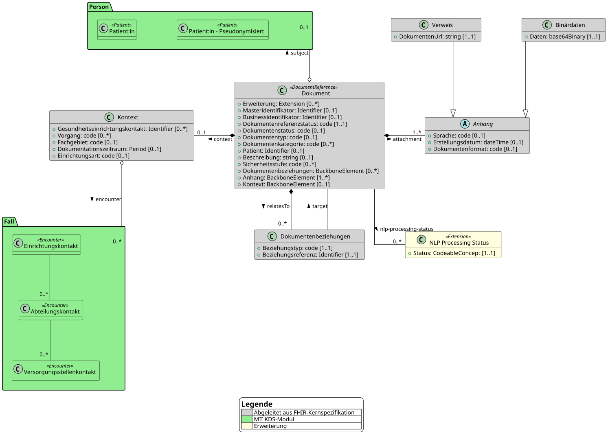

# UML-Diagramme - MII IG Dokument v2027.0.0-ballot.2

* [**Table of Contents**](toc.md)
* [**Anleitung**](guidance.md)
* **UML-Diagramme**

## UML-Diagramme

Diese Seite enthält Übersetzungen aus der Originalsprache, in der der Leitfaden verfasst wurde. Informationen zu diesen Übersetzungen und Anweisungen zum Abgeben von Feedback zu den Übersetzungen finden Sie [hier](translationinfo.md).

Das Informationsmodell des Moduls ist im nachfolgenden Diagramm in der Unified Modeling Language (UML) festgelegt. Es zeigt die Fachkonzepte, deren Zusammenhänge sowie den Bezug zu weiteren MII KDS-Modulen. Das Informationsmodell ist vom Nationalen Steuerungsgremium (NSG) der MII beschlossen; das [Logical Model](logical-models.md) und die FHIR-Profile setzen es um.

Mit einem **Dokument** lassen sich die Metadaten zu einem klinischen Dokument, einer Bild-, Audio- oder Videodatei beschreiben. Ein **Dokument** wird in der Regel in einem klinischen **Kontext** (`context`) erzeugt. Darüber hinaus kann ein **Dokument** auf eine bestimmte Art und Weise in Beziehung (`relatesTo`) zu einem oder mehreren anderen **Dokumenten** stehen, abhängig vom jeweiligen Szenario. Über einen oder mehrere **Anhänge** (`attachment`) lassen sich Details zum Speicherort und -format des klinischen Dokuments, der Bild-, Audio- oder Videodatei festlegen; jeder **Anhang** ist entweder **Binärdaten** oder ein **Verweis**. In einer NLP-Pipeline beschreiben ein oder mehrere **NLP Processing Status** (`nlp-processing-status`) den erreichten Verarbeitungsstand eines **Dokuments**.

Ein **Dokument** kann in Abhängigkeit vom Szenario einen Patientenbezug (`subject`) ([MII KDS-Modul Person](https://simplifier.net/packages/de.medizininformatikinitiative.kerndatensatz.base)) aufweisen. Der Patientenbezug kann anhand identifizierender Eigenschaften, pseudonym oder anonym erfolgen. Analog lässt sich über einen klinischen **Kontext** der Bezug zum konkreten Fall (`encounter`) ([MII KDS-Modul Fall](https://simplifier.net/packages/de.medizininformatikinitiative.kerndatensatz.base)) herstellen.

Die Module Person und Fall sind seit dem KDS-Release 2026 im Basismodul (Package `de.medizininformatikinitiative.kerndatensatz.base`) aufgegangen; die Canonical-URLs der referenzierten Profile sind unverändert. Das Diagramm zeigt den vom NSG beschlossenen Stand.

