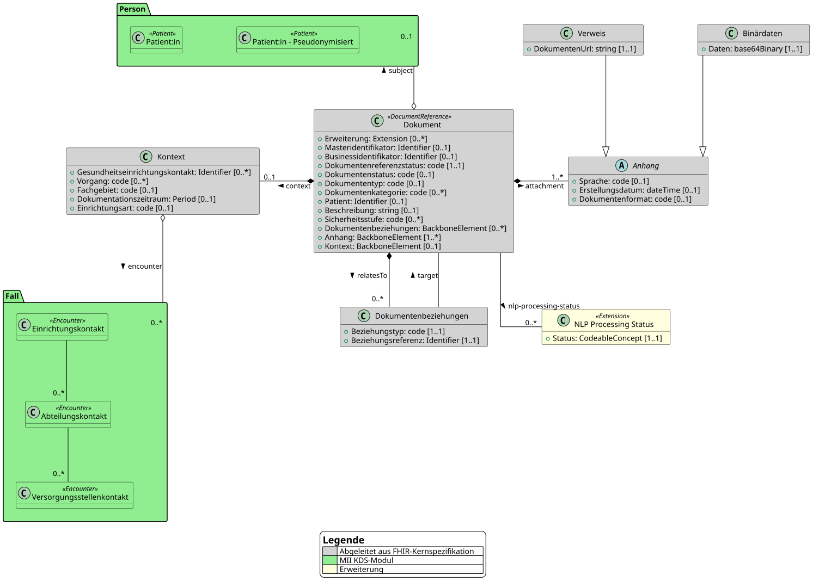

# UML Diagrams - MII IG Dokument v2027.0.0-ballot.2

* [**Table of Contents**](toc.md)
* [**Guidance**](guidance.md)
* **UML Diagrams**

## UML Diagrams

The information model of the module is specified in the following diagram in the Unified Modeling Language (UML). It shows the domain concepts, their relationships and the connection to other MII KDS modules. The information model was decided by the MII National Steering Committee (NSG); the [logical model](logical-models.md) and the FHIR profiles implement it.

A **Dokument** (document) is used to describe the metadata of a clinical document, or an image, audio, or video file. A **Dokument** is typically created in a clinical **Kontext** (context) (`context`). In addition, depending on the scenario, a **Dokument** can be related (`relatesTo`) in a specific way to one or more other **Dokumente**. One or more **Anhänge** (attachments) (`attachment`) are used to specify details about the storage location and format of the clinical document, or the image, audio, or video file; each **Anhang** is either **Binärdaten** (binary data) or a **Verweis** (reference). In an NLP pipeline, one or more **NLP Processing Status** entries (`nlp-processing-status`) describe the processing state a **Dokument** has reached.

Depending on the scenario, a **Dokument** can have a reference to a patient (`subject`) ([MII KDS module Person](https://simplifier.net/packages/de.medizininformatikinitiative.kerndatensatz.base)). The patient reference can be established using identifying attributes, or on a pseudonymous or anonymous basis. Similarly, a clinical **Kontext** (context) can be used to establish the reference to the specific case/encounter (`encounter`) ([MII KDS module Fall](https://simplifier.net/packages/de.medizininformatikinitiative.kerndatensatz.base)).

Since the KDS release 2026, the modules Person and Fall have been folded into the base module (package `de.medizininformatikinitiative.kerndatensatz.base`); the canonical URLs of the referenced profiles are unchanged. The diagram shows the state decided by the NSG.

